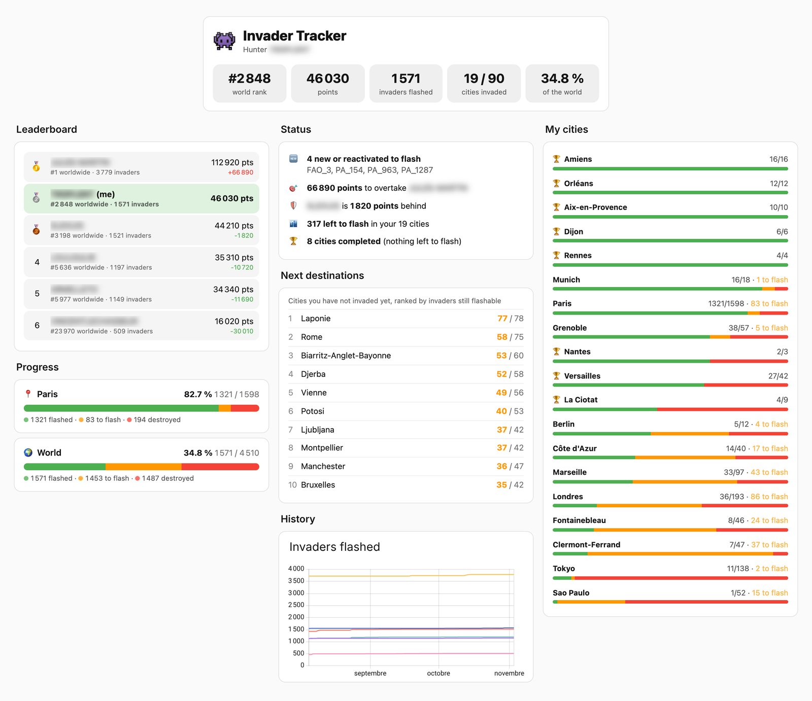

# Showcase dashboard



A ready-made dashboard built only from the integration's entities: profile header, leaderboard of followed players, status, Paris & world progress, per-city progress and the next cities worth a trip.

## Requirements

- Invader Tracker with your Flash Invader UID (profile + followed players) and an Awazleon API key (city data)
- [button-card](https://github.com/custom-cards/button-card) — install it from HACS → Frontend

## Install

1. **Settings → Dashboards → Add dashboard** → *New dashboard from scratch*, then open it.
2. **⋮ → Edit dashboard → ⋮ → Raw configuration editor**.
3. Paste the content of [`dashboard-example.yaml`](dashboard-example.yaml) and save.
4. In the *History* section, replace `sensor.user_mypseudo_…` / `sensor.user_friend_…` with your own entities.

Players and cities are discovered automatically from the entities' names (`User - <pseudo> Score`, `City - <name> Total Invaders`), so renaming entity IDs does not break the cards. The *Progress* section shows Paris by default: change `city: Paris` to any tracked city, or leave it empty (`city: ''`) for the world total.

Colours: 🟢 flashed · 🟠 still flashable · 🔴 destroyed before you flashed it.

## Optional: city picker with progress

A drop-down listing every tracked city as `City · flashed/total`, refreshed after each flash.

**Helper** — Settings → Devices & services → Helpers → *Dropdown*, named `Invader city` (entity `input_select.invader_city`), with any placeholder option.

**Automation** — fills the options:

```yaml
alias: Invader Tracker – city picker options
triggers:
  - trigger: homeassistant
    event: start
  - trigger: time
    at: "04:30:00"
  - trigger: state
    entity_id: sensor.user_mypseudo_invaders_found   # your profile
mode: restart
actions:
  - variables:
      cities: >-
        
        
          
          
        
        {{ ns.o }}
      current: "{{ states('input_select.invader_city').split(' · ')[0] }}"
  - action: input_select.set_options
    target:
      entity_id: input_select.invader_city
    data:
      options: "{{ cities }}"
  - variables:
      choice: >-
        
        
        {{ ns.c }}
  - if: "{{ choice != '' }}"
    then:
      - action: input_select.select_option
        target:
          entity_id: input_select.invader_city
        data:
          option: "{{ choice }}"
```

**Cards** — add to the *Progress* section:

```yaml
- type: tile
  entity: input_select.invader_city
  name: City
  features:
    - type: select-options
  features_position: inline
- type: custom:button-card
  template: invader_progress
  variables:
    city: "[[[ return (states['input_select.invader_city']?.state || '').split(' · ')[0]; ]]]"
```
